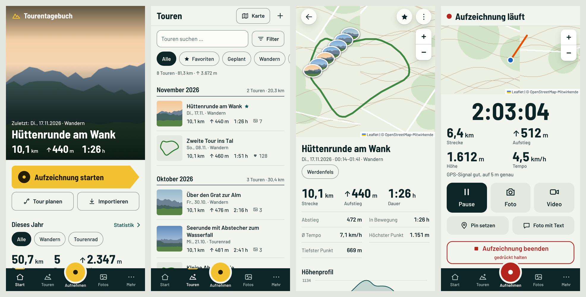

# Mein Tourentagebuch

Eigenständige Android-App: Touren, Fotos, Aufzeichnung, Planung und Routing – **alles lokal auf dem Handy**, ohne Server.

## Installation und Prüfung
1. Auf GitHub **Releases** öffnen, die neueste Version wählen und **Tourentagebuch.apk** laden (daneben liegt **Tourentagebuch.apk.sha256**).
2. Datei öffnen. Android fragt einmal, ob der Browser oder Dateimanager Apps installieren darf – erlauben.
3. Google Play Protect kann die App prüfen oder warnen, weil sie nicht aus dem Play Store kommt. Die Prüfung zulassen und nach eigener Abwägung fortfahren.
4. **Prüfsumme vergleichen** (optional, aber empfohlen): `sha256sum Tourentagebuch.apk` muss denselben Wert ergeben wie in der Versionsbeschreibung bzw. in der `.sha256`-Datei (`sha256sum -c Tourentagebuch.apk.sha256` im selben Ordner). Unter Windows: `certutil -hashfile Tourentagebuch.apk SHA256`.
5. **Signatur:** Veröffentlichte Versionen sind mit dem Schlüssel des Projekts signiert ([docs/signieren.md](docs/signieren.md)); Android installiert Updates nur über dieselbe Signatur. Selbst gebaute oder Test-APKs tragen eine andere Signatur und lassen sich nicht über eine veröffentlichte Version legen. Die Signatur zeigt `apksigner verify --print-certs Tourentagebuch.apk`.

**Datenschutz:** Touren, Fotos und Einstellungen bleiben auf dem Gerät (Datenbank in der App, Android-Datensicherung ist ausgeschaltet); im Code gibt es keine Werbung, Analyse- oder Absturzmeldedienste. Das Internet nutzt die App für Karten-Kacheln (OpenStreetMap, OpenTopoMap, Satellitenbilder), Routing (BRouter), Ortsnamen und Wegedaten (OpenStreetMap), Höhendaten und Wetter (Open-Meteo) sowie für Importe und Abgleiche, die du selbst startest (Komoot, Strava, Zepp, Meine Touren, Nextcloud/WebDAV).
Berechtigungen: Standort (Aufzeichnung), Fotos und deren Aufnahmeort (Zuordnung zu Touren), Benachrichtigungen (laufende Aufzeichnung).

## Bedienung
Fünf Reiter: **Start** (letzte Tour, Aufzeichnen · Planen · Importieren, das laufende Jahr), **Touren** (Liste und Karte), **Aufnehmen**, **Fotos**, **Mehr** (Tour planen, Reisen & Alben, Statistik, Import, Foto-Quellen, Einstellungen & Sicherung). Was sich mit 2.0 geändert hat: [docs/versionen/2.0.0.md](docs/versionen/2.0.0.md). Aufstieg wie in „Meine Touren“ (2.0.1): [docs/versionen/2.0.1.md](docs/versionen/2.0.1.md).

## Funktionen
- **Start**: die letzte Tour groß, die drei Hauptaktionen, „Dieses Jahr“ mit Zielen, letzte Touren, „An diesem Tag“; Hinweis, wenn die Sicherung fällig ist. Welche Bausteine erscheinen, steht unter Einstellungen → Startseite (Wochen-Serie und Fitness lassen sich einschalten).
- **Touren**: Liste mit Miniatur (Foto oder Strecke), Suche, Chips (Favoriten, Geplant, Sportart), Filter (Jahr, Region), Detail mit Karte, Höhenprofil (berührbar), Kennzahlen, Notiz, GPX-Export.
- **Karte** (Touren → Karte): alle Touren nach Sportart gefärbt, Fotos als Marker, Offline-Kacheln für den sichtbaren Ausschnitt.
- **Fotos**: Raster nach Tag, Vollbild mit Wischen und Diashow, automatische Zuordnung zu Touren per Aufnahmezeit, Position aus der Spur berechnet, wenn das Foto keine hat.
  Quellen: Galerie (auch automatisch passend zu allen Touren), beliebige Ordner, **SMB-Freigaben** (NAS, Fritz!Box), **Nextcloud/WebDAV**, Teilen-Menü, Kamera während der Aufzeichnung.
- **Aufzeichnen**: GPS im Hintergrund (Vordergrunddienst), Pause, Foto, Sprachansagen auf geplanter Route (Abbiegen, Abweichung, Restkilometer), Sicherung bei Absturz.
- **Planen**: Wegpunkte setzen, Routing auf Wegen (BRouter) je Sportart, Rundtour, Umkehren, Höhenprofil, Zeitschätzung, Speichern, GPX, „Speichern & starten“ mit Ansagen.
  Auf der Seite der geplanten Tour: **Notizen & Quellen** (Notiz, Herkunft, bis 20 Links – nie automatisch abgerufen) und **Passt die Tour zu mir?** (Strecke, Aufstieg, Dauer gegen die eigenen Touren; Tageslicht mit Datum, Startzeit und Pausenpuffer).
- **Nach der Tour**: **Wie ist es gelaufen?** (Einordnung gegen die eigenen Touren der 12 Monate davor, ab 5 Vergleichstouren) oder **Plan und Ergebnis** (geplant gegen gelaufen, wenn die Tour aus einer Planung gestartet oder von Hand verknüpft wurde).
- **Import**: Dateien (GPX/FIT/TCX/ZIP/GZ), Komoot, Strava, Zepp/Amazfit (E-Mail/Passwort oder Token für Google-, Apple- und Mi-Konten), Bosch eBike Flow (Datei/Teilen), Garmin/Suunto/Polar/Wahoo/Coros (Export, Teilen-Menü, überwachter Ordner), Link. Duplikate werden erkannt.
  Der Zepp-Import legt auf Wunsch (Vorgabe: an) die Barometerhöhen der Uhr auf vorhandene Touren aus Komoot, Dateien oder eigener Aufzeichnung – rückholbar an der Tour.
- **Aus „Meine Touren“ holen** (Mehr → Touren importieren → Meine Touren): Wer daneben die Server-App „Meine Touren“ betreibt, verbindet sie mit Serveradresse, Name und Passwort
  (bei Zwei-Faktor mit Code). Ein Betrachter-Konto („nur ansehen“) genügt und wird empfohlen; die App liest nur. Neue Touren kommen mit Strecke, vorhandene bekommen Name, Sportart, Notiz – und auf
  Wunsch Strecke und Aufstieg aus Meine Touren als maßgebliche Zahlen, damit beide Apps dasselbe zeigen. Gemerkt wird nur ein Sitzungsschlüssel (nie das Passwort, nie in der Sicherung).
  Einzelheiten: `docs/versionen/2.1.0.md`.
- **Jahresrückblick** (Mehr → Jahresrückblick, im Dezember und Januar groß auf der Startseite): dein Jahr in Zahlen (wie in der Statistik), Vergleich mit dem Vorjahr, Sportarten, Höhepunkte, Monate als Diagramm, Regionen, Fotos und **„Als Bild teilen“** (Karte 1080 × 1350). Einzelheiten: `docs/versionen/2.3.0.md`.
- **Wanderführer** (Mehr → Wanderführer): Bücher mit mehreren GPX-Dateien (auch ZIP) anlegen; die Seite zeigt je Buch „x von y gewandert“ mit Ring, die Tourenliste mit ✓ gewandert (Datum, Link zur Tour) und ○ offen (Karte der Buchstrecke, **Als Planung übernehmen**), Filter Alle/Offen/Gewandert, Suche, Reihenfolge, eigenes **Titelbild** (du wählst es selbst; es wird auf 400 px verkleinert) und eine ruhige Zeile auf der Startseite. „Gewandert“ = eine Tour folgt der Buchstrecke (gleiche Regel wie in Meine Touren, auch rückwärts). Einzelheiten: `docs/versionen/2.4.0.md`.
- **Alles abgleichen** (Import-Seite oben, Startseite): Zepp, Komoot und Meine Touren nacheinander mit den gespeicherten Einstellungen, ein Fortschrittsfenster, eine Zeile je Quelle; optional beim Öffnen automatisch (höchstens einmal am Tag). Dazu **eigene Bewertung** (1–5 Sterne, Filter, Sicherung) und getrennte **Wintersportarten** (Ski alpin, Skitour, Langlauf; Schneeschuh = Wandern + Schlagwort). Einzelheiten: `docs/versionen/2.2.0.md`.
- **Doppelte Touren prüfen** (Mehr → Touren importieren → Aufräumen): findet dieselbe Tour aus zwei Quellen, schlägt vor, welche bleibt, und führt auf Wunsch zusammen
  (Fotos, Puls, Notiz, Pins, Zuordnungen wandern mit) – oder merkt sich „keine Doppelten“. Nie von selbst.
- **Heimatort** (Mehr → Einstellungen): Ort oder Adresse suchen und übernehmen; dient als Kartenmitte der Planung.
- **Erzählung** (Tour öffnen → ⋮ → „Erzählung“): die Tour als Zeitleiste mit Start, Fotogruppen und Ziel, Ortsnamen (OpenStreetMap, zwischengespeichert), Fotostandorten auf der Karte und **Kommentaren zu Fotos** (lokal auf dem Handy).
- **Reisen & Alben**, **Statistik** (Übersicht, Bestwerte mit Wochen-Serie, Kalender, Auswertung, **Ziele** für Jahr und Woche mit Prognose, **Fitness-Einordnung** der letzten 12 Wochen – Orientierung, keine medizinische Aussage), **Sicherung/Wiederherstellung** (`.mtl`, nimmt Ziele, Planungsnotizen und Einstellungen mit) – alle unter „Mehr“. Hell/Dunkel automatisch.

## Aufbau
- `android/` – Java-Hülle: WebView unter `https://app.local/`, Brücke `MTApp` (Netzwerk ohne CORS, Dateien, Fotos/EXIF, SMB, Aufnahmedienst, TTS).
- `android/app/src/main/assets/www/` – Oberfläche (HTML/CSS/JS ohne Framework und ohne Bauschritt), Daten in IndexedDB. `app.css` enthält das Gestaltungssystem, `js/ui.js` die Bausteine (Abschnitt, Kennzahl, Liste, Chip, Schalter, leerer Zustand …), `js/icons.js` die Symbole, `js/v-*.js` je eine Ansicht.
- `docs/gestaltung-2.0.md` – Gestaltungsregeln (Farben, Schrift, Abstände, Navigation) und die Liste der Bausteine.
- `tests/` – `test_parse.js` (Parser), `test_calc.js` (Rechenlogik für Ziele, Rückblick, Planungshilfe, Fitness, Aufstieg, doppelte Touren), `test_web.py` (Playwright mit simulierter Brücke: Abläufe, Navigation, Querrollen, Tippflächen), `audit_kontrast.py` (Kontrast in Hell und Dunkel), `android/*Check.java` (Aufnahme und Ansagen).
  `check_meine_touren.py` (nicht in der CI) startet einen echten „Meine Touren“-Server aus dem Nachbarordner mit Testdaten und prüft den Abgleich dagegen; mit `--fixtures` schreibt es die bereinigten Antworten nach `tests/data/meine-touren-beispiel.json`, die `test_web.py` abspielt.

## Bauen
Per GitHub Actions (`.github/workflows/android.yml`) oder lokal mit Android SDK: `gradle -p android assembleDebug`.
Tests: `node tests/test_parse.js`, `node tests/test_calc.js`, `python3 tests/test_web.py`, `python3 tests/audit_kontrast.py --fail`.

## Verkauf
Siehe [COMMERCIAL.md](COMMERCIAL.md) (Lizenzen, Kartenserver, Dienste, Schlüssel).

## Lizenz

MIT-Lizenz, siehe [LICENSE](LICENSE). Mitgelieferte Bibliotheken haben eigene Lizenzen (siehe [COMMERCIAL.md](COMMERCIAL.md)).

Signieren: Veröffentlichte APKs sind mit einem geheimen Schlüssel signiert (nicht im Repository). Wer selbst baut, bekommt den normalen Android-Testschlüssel; Anleitung in [docs/signieren.md](docs/signieren.md).
