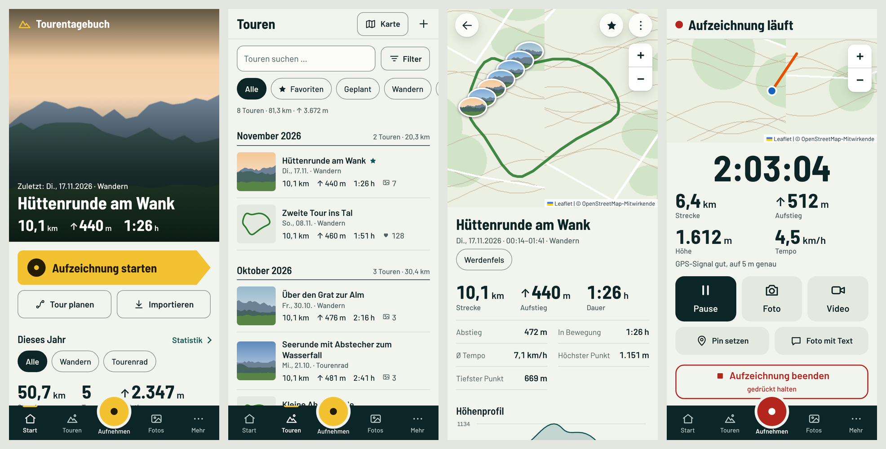
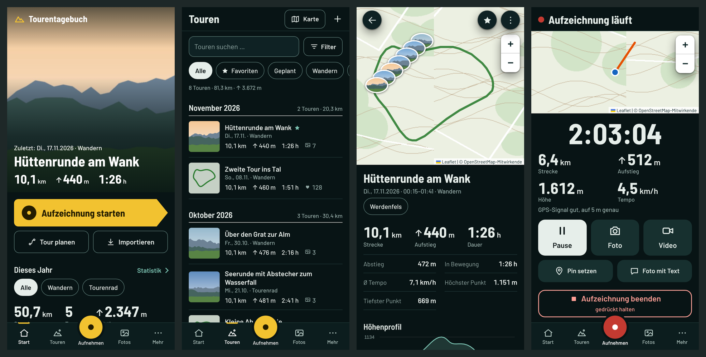
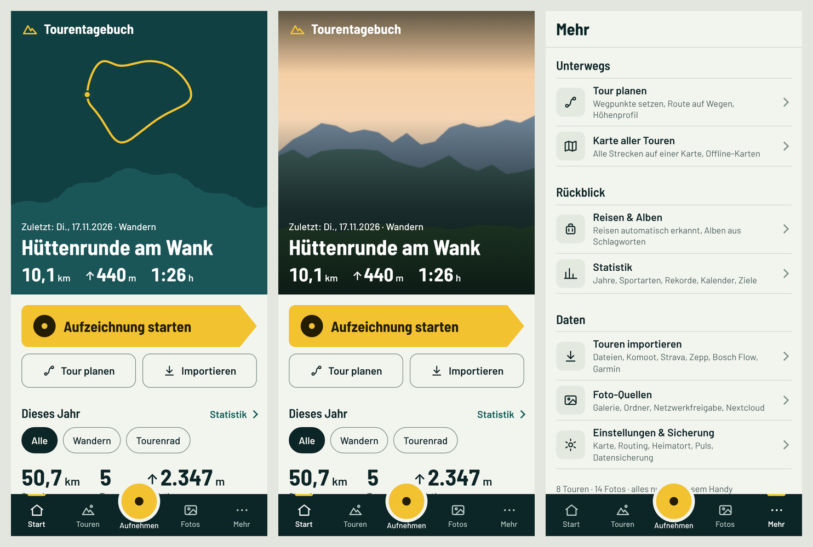
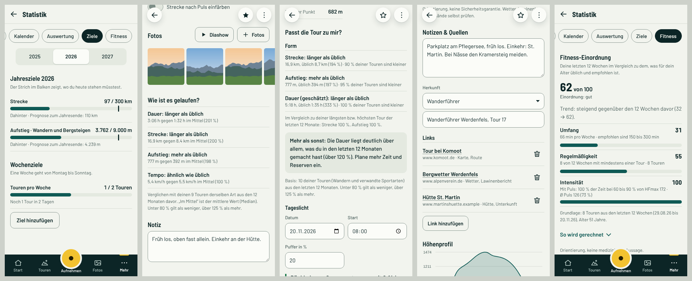
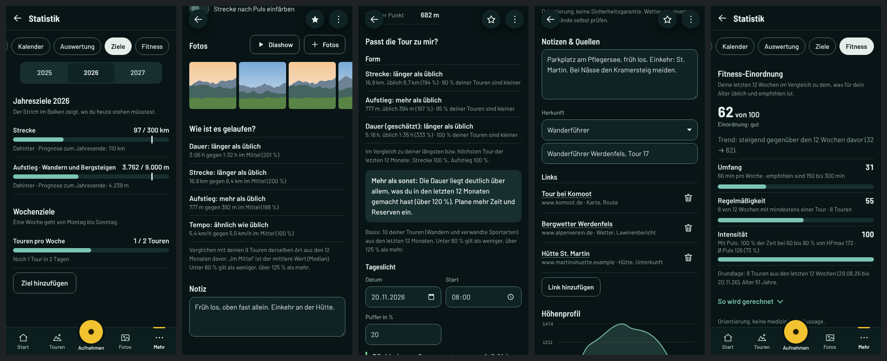
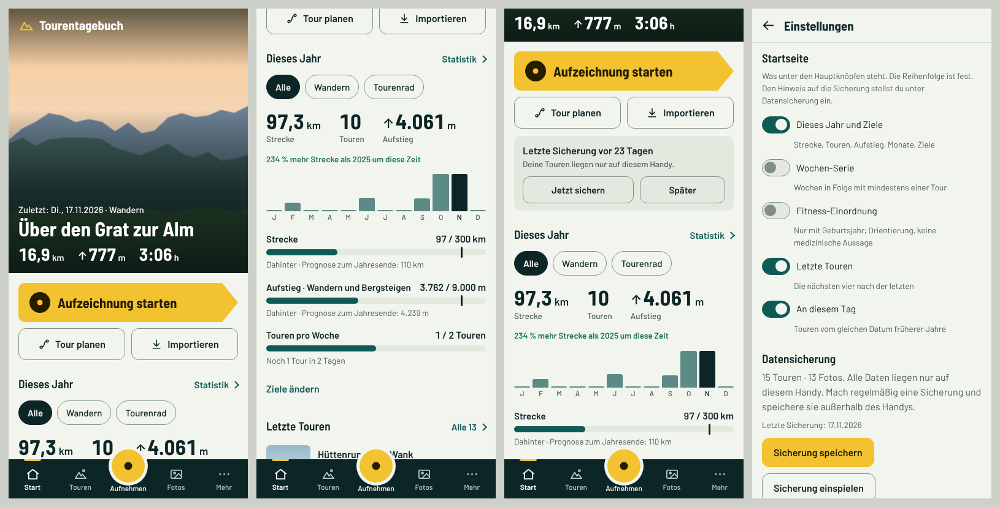
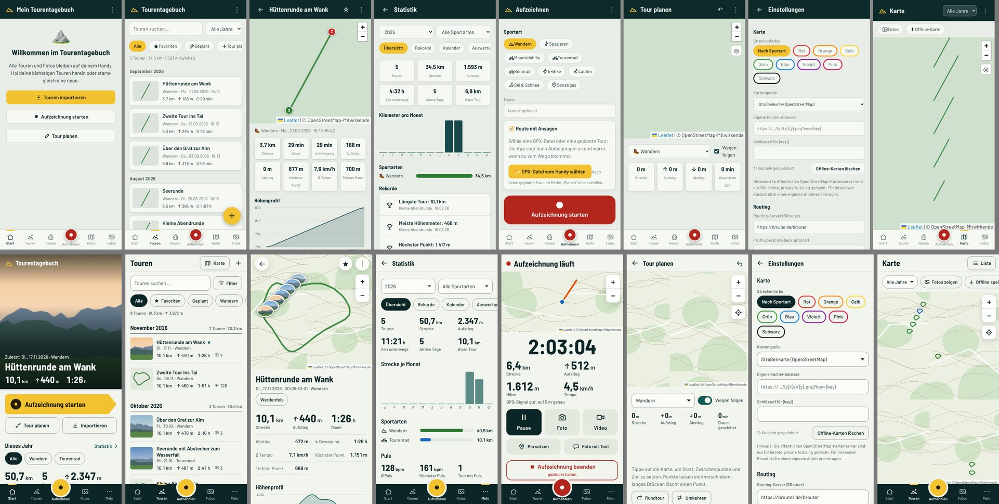

# 2.0.0 – Neue Oberfläche, neue Funktionen

Die App sieht neu aus und ist neu sortiert. Dazu kommen Funktionen aus der Schwester-App „Meine Touren“: Ziele,
Rückblick, Planungshilfe, Fitness-Einordnung und eine Erinnerung an die Sicherung. Daten und Sicherungen (`.mtl`)
bleiben, wie sie sind – es gibt nichts umzustellen.

## Was sich ändert

- **Startseite als Übersicht:** Oben steht groß die letzte Tour – mit Foto, sonst mit Kartenausschnitt, ohne Netz als
  Zeichnung aus Strecke und Höhenprofil. Ein Tipp öffnet sie. Darunter die drei Hauptaktionen: **Aufzeichnung starten**
  (gelbes Wegweiserschild), **Tour planen**, **Importieren**. Dann „Dieses Jahr“ (Strecke, Touren, Aufstieg, Monate,
  Jahresziele), „Letzte Touren“ und „An diesem Tag“.
- **Fünf Reiter statt sechs:** Start · Touren · Aufnehmen · Fotos · Mehr. „Aufnehmen“ sitzt in der Mitte als gelbe
  Scheibe; sie wird rot, solange eine Aufzeichnung läuft.
- **Tourenliste ruhiger:** eine Zeile je Tour mit Miniatur (Foto oder Strecke), Name, „Datum · Sportart“ und Strecke,
  Aufstieg, Dauer. Monatsüberschriften zeigen Anzahl und Strecke. Suche und Chips bleiben oben; Jahr und Region liegen
  hinter **Filter** (der Knopf zählt, wie viele gesetzt sind).
- **Tourseite:** Karte oben, darunter der Name und die drei wichtigsten Zahlen groß; Abstieg, Zeit in Bewegung, Tempo,
  höchster und tiefster Punkt, Puls als leise Tabelle. Alle Aktionen stehen im Menü ⋮, nach Zweck gruppiert.
- **Aufzeichnen:** Laufzeit und Werte in sehr großen Ziffern, gut lesbar in der Sonne. Der Seitentitel sagt
  „Aufzeichnung läuft“ oder „Pause“. „Aufzeichnung beenden“ steht abgesetzt und reagiert weiter nur auf Halten.
- **Einheitliche Gestaltung** in allen Ansichten: Papier und Tinte statt Kästchen, gezeichnete Symbole statt Emojis,
  größere Tippflächen (mindestens 44 px), deutlicher Tastaturfokus, Hell und Dunkel automatisch.

## Wo jetzt was liegt

| Bisher                                   | Jetzt                                                              |
|------------------------------------------|--------------------------------------------------------------------|
| Reiter „Reisen“                          | **Mehr → Reisen & Alben**                                          |
| Reiter „Karte“                           | **Touren → Karte** (oben rechts; von dort „Liste“ zurück), auch unter Mehr |
| Menü ⋮ oben rechts (Import, Statistik …) | Reiter **Mehr**: Tour planen, Karte, Reisen & Alben, Statistik, Touren importieren, Foto-Quellen, Einstellungen & Sicherung |
| Runder „＋“-Knopf in der Tourenliste      | **＋** oben rechts: Tour planen, Touren importieren, Aufzeichnung starten |
| Jahr und Region über der Tourenliste     | Knopf **Filter** neben der Suche                                   |
| „Tour planen“ als Chip in der Liste      | Startseite, ＋ in der Tourenliste, Mehr, Seite „Aufnehmen“          |
| Blättern durch ältere Touren im Aufmacher | entfällt; die nächsten vier stehen unter „Letzte Touren“           |

Die Zurück-Taste führt von Unterseiten zurück, von einem Reiter zur Startseite; auch eine laufende Diashow schließt sie jetzt.

## Behoben

- Statistik → Rekorde (jetzt „Bestwerte“) und → Auswertung zeigten an einigen Stellen das Wort „null“ bzw. „[object …]“ statt nichts.
- Nach einem Import über das Teilen-Menü zeigte die Startseite weiter „Willkommen“, bis man die Seite wechselte.
- Ausgeblendete Elemente (z. B. die Regionsauswahl ohne Regionen) konnten sichtbar bleiben.
- Der Pulswert in Listen blinkt nicht mehr.

## Neue Funktionen

Alles rechnet auf dem Handy aus den eigenen Touren. Es gibt keine neuen Netzaufrufe.

| Funktion | Wo | Was sie tut |
|----------|----|-------------|
| **Ziele** | Statistik → Ziele; Anzeige auf der Startseite unter „Dieses Jahr“ | Jahres- und Wochenziele für Strecke, Aufstieg, Touren oder Zeit, je Sportart oder Sportgruppe. Balken mit Soll-Marke und ein Satz zum Stand („Im Plan · Prognose zum Jahresende: 820 km“). Die Prognose gibt es ab dem 14. Tag des Jahres. |
| **Bestwerte und Wochen-Serie** | Statistik → Bestwerte | Längste Strecke, größter Aufstieg, längste Dauer, höchster Punkt, stärkster Monat – wahlweise der beste oder die besten drei. Darunter die Serie der Wochen mit mindestens einer Tour. |
| **Rückblick „Wie ist es gelaufen?“** | Tourseite, über der Notiz | Dauer, Strecke, Aufstieg und Tempo der Tour gegen die eigenen Touren derselben Sportart aus den 12 Monaten davor (mittlerer Wert; unter 80 % weniger, über 125 % mehr). Erscheint erst ab 5 Vergleichstouren – sonst gar nicht. |
| **Notizen & Quellen** | Seite einer geplanten Tour | Notiz zur Planung, Herkunft (z. B. Wanderführer, Komoot) und bis zu 20 Links. Nur Adressen mit `http://` oder `https://`. Die App ruft Links nie selbst ab; sie öffnen erst auf Tipp im Browser. |
| **Passt die Tour zu mir?** | Seite einer geplanten Tour | *Form:* Strecke, Aufstieg und geschätzte Dauer gegen die eigenen Touren der letzten 12 Monate, mit Hinweis, wenn die Tour deutlich über allem Bisherigen liegt. *Tageslicht:* Sonnenaufgang und -untergang am Startpunkt, Rückkehr aus Datum, Startzeit und Pausenpuffer (Vorgabe 09:00 Uhr, 20 %). Links der Art „Wetter, Lawinenbericht“ stehen hier noch einmal. Orientierung, keine Sicherheitsgarantie. |
| **Plan und Ergebnis** | Tourseite (statt des Rückblicks) | Geplant gegen gelaufen: Strecke, Aufstieg, Dauer. Die Verknüpfung entsteht von selbst, wenn die Aufzeichnung aus einer Planung gestartet wurde („Mit Ansagen starten“, „Speichern & starten“) – oder von Hand über ⋮ → „Mit Plan vergleichen“. Sie lässt sich wieder lösen. |
| **Fitness-Einordnung** | Statistik → Fitness; als Baustein der Startseite einschaltbar | Umfang, Regelmäßigkeit und Intensität der letzten 12 Wochen im Verhältnis zum Alter, als Wert von 0 bis 100 mit Trend. Braucht das Geburtsjahr (nur das Jahr; Statistik → Fitness oder Einstellungen). „So wird gerechnet“ nennt Formeln und Quellen. Orientierung, keine medizinische Aussage. |
| **Sicherungs-Erinnerung** | Startseite, unter den Hauptknöpfen | Ruhiger Hinweis, wenn die letzte Sicherung älter als 14 Tage ist (einstellbar: 7, 14, 30 Tage oder aus) – mit „Jetzt sichern“ und „Später“ (7 Tage Ruhe). |
| **Startseite einrichten** | Einstellungen → Startseite | Schalter je Baustein: Dieses Jahr und Ziele, Wochen-Serie, Fitness-Einordnung, Letzte Touren, An diesem Tag. Vorgabe: Wochen-Serie und Fitness sind aus. |

### Daten und Sicherung

- **Nichts wird umgestellt.** Neu sind nur zusätzliche Einträge in der Merkliste (`goals2` für Ziele, `pn:<Tour>` für Notizen
  und Links einer Planung), zusätzliche Einstellungen (Geburtsjahr, Startseite, Erinnerungsschwelle, Bestwerte) und ein
  optionales Feld `plan` an einer Tour (die verknüpfte Planung). Touren, Spuren und Fotos bleiben unverändert.
- **Ältere Jahresziele** bleiben lesbar und gehen beim ersten Ändern in die neue Liste über.
- **Alte Sicherungen laden weiter.** Eine `.mtl` aus 1.x lässt sich wie bisher einspielen.
- **Die Sicherung nimmt jetzt mehr mit.** Bisher holte „Sicherung einspielen“ nur Touren, Spuren und Foto-Einträge zurück.
  Jetzt kommen auch Ziele, Notizen und Links der Planungen, die Planungspunkte, Reisenamen und die Einstellungen
  (Geburtsjahr, Startseite, Erinnerung …) zurück. Vorhandenes wird dabei nicht überschrieben: Einstellungen füllen nur,
  was auf dem Gerät noch auf Vorgabe steht; Ziele werden ergänzt. Zugangsdaten (Komoot, Strava, Zepp, NAS) waren und
  sind nicht Teil der Sicherung.
- Das Geburtsjahr bleibt auf dem Handy. Es steht in keiner Diashow, keinem GPX-Export und keinem Teilen-Text – nur in der
  eigenen Sicherung.

### Bewusst nicht übernommen

„Meine Touren“ läuft auf einem Server, diese App nur auf dem Handy. Deshalb fehlen: mehrere Benutzer, Freigabelinks,
der Ansichten-Baukasten, die Geräteverwaltung und die vier Sprachen (die App bleibt deutsch). Im Rückblick fehlt der
Vergleich mit „ähnlichen Touren“ (dieselbe Strecke noch einmal gegangen): Die App erkennt Wiederholungen nicht. Bei
„Passt die Tour zu mir?“ fehlt der Abgleich mit der Belastung aus Uhr-Werten.

Abweichungen vom Vorbild: Das Tageslicht rechnet für den Startpunkt, zeigt die Uhrzeiten aber in der Zeitzone des
Handys (das Vorbild in der Zeitzone des Servers). Die Dauer einer Planung ist die Schätzung des Planers. Plan und Tour
werden über den Namen der aktiven Route verknüpft, nicht über eine Kennung im Aufnahmedienst.

## Für die Weiterarbeit

Die Rechenlogik der neuen Funktionen liegt ohne Oberfläche in `js/calc-ziele.js`, `js/calc-rueckblick.js`,
`js/calc-planhilfe.js` und `js/calc-fitness.js` und wird von `node tests/test_calc.js` gegen Werte aus den
Python-Vorbildern geprüft. Die Ansichten dazu: `js/v-ziele.js`, `js/v-tourhilfe.js`, `js/v-fitness.js`, die Sicherung
in `js/backup.js`.

Gestaltungsregeln, Farben, Schrift und die wiederverwendbaren Bausteine (`js/ui.js`, `Home.add` für die Startseite)
stehen in [docs/gestaltung-2.0.md](../gestaltung-2.0.md).

## Bilder

Die Bilder stammen aus dem Testlauf im Browser; Karte und Fotos darin sind künstlich erzeugte Platzhalter.
